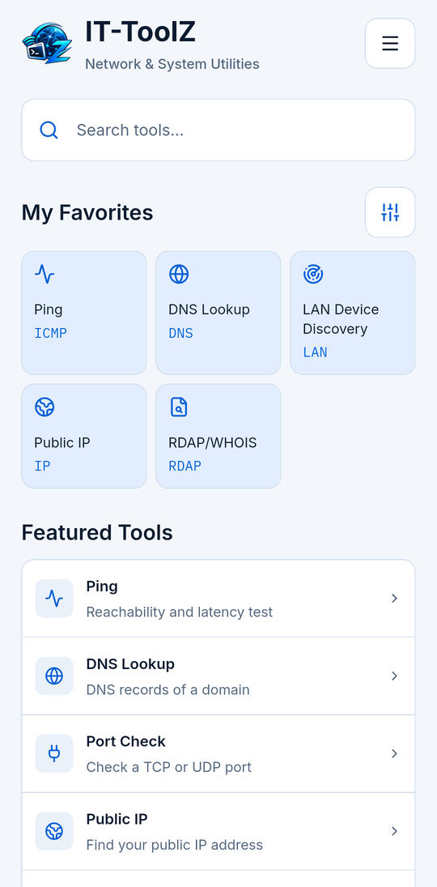
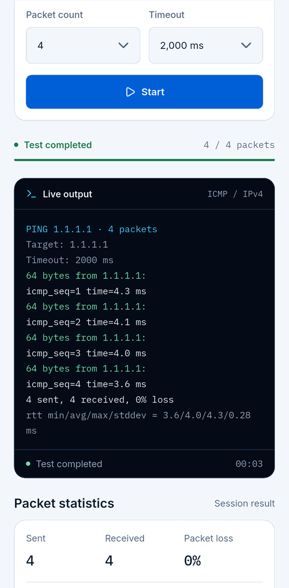
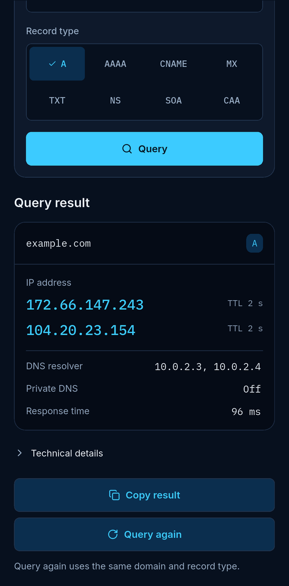

  

  <b>Network &amp; System Utilities</b> 
  Netzwerk- und Systemwerkzeuge für IT-Profis, direkt in der Hosentasche. 
  Kein Konto. Keine Werbung. Kein Tracking.

  
  

  <a href="README.md">English</a> · <a href="README.tr.md">Türkçe</a> · <b>Deutsch</b> · <a href="README.es.md">Español</a> · <a href="README.pt-BR.md">Português (Brasil)</a> · <a href="README.fr.md">Français</a> · <a href="README.ru.md">Русский</a>

---

## Was ist IT-ToolZ?

Ein fokussiertes Werkzeugset für IT- und Netzwerkprofis, die unterwegs schnell Antworten brauchen. Neunzehn Tools und eine Netzwerkübersicht direkt auf dem Gerät, ohne Konto, Werbung oder Tracking.

## Tools

### Netzwerk-Tools

- **Ping** – Erreichbarkeit, Latenz
- **Traceroute** – Pfad, Hop für Hop
- **DNS Lookup** – Alle Eintragstypen
- **Reverse DNS** – Name zur IP
- **Port Check** – TCP- und UDP-Ports
- **Subnet Calculator** – Bereiche, Masken, Hosts
- **IP Converter** – IP-Formate umwandeln
- **Public IP** – Ihre IPv4 und IPv6
- **NTP Time Checker** – Uhrabweichung zu NTP
- **Wake-on-LAN** – PCs aus der Ferne wecken *(Android)*
- **LAN Device Discovery** – Geräte im LAN

### Sicherheit & Zertifikate

- **SSL Certificate Checker** – Kette, Gültigkeit, Vertrauen
- **RDAP/WHOIS** – Domain- & IP-Register
- **Password Generator** – Starke Zufallspasswörter

### Entwickler-Tools

- **HTTP Headers** – Header, Weiterleitungen
- **Hash Generator** – MD5, SHA-1, SHA-256
- **Base64** – Kodieren und dekodieren
- **URL Encoder/Decoder** – Prozent-Kodierung
- **JSON Formatter** – Formatieren, validieren

## Screenshots

  
  
  

Screenshots mit englischer Oberfläche.

## Download

Android 10 oder neuer · iOS 16 oder neuer, iPhone und iPad

  
  

## Datenschutz

Kein Konto, keine Analyse, keine Werbung, kein eigener Server. Verlauf und Favoriten bleiben auf Ihrem Gerät. Netzwerkanfragen gehen nur an die von Ihnen gewählten Ziele und an die Dienste, die eine Abfrage braucht (Ihr DNS-Resolver, RDAP-Register und ipwho.is für IP-Details, ipify/ifconfig.me als Ausweichlösung). Details stehen in der Datenschutzerklärung.

---

Die ausführliche Seite ist auf Englisch: [README.md](README.md) · [Datenschutzerklärung](PRIVACY.md) · [Änderungen](CHANGELOG.md)
