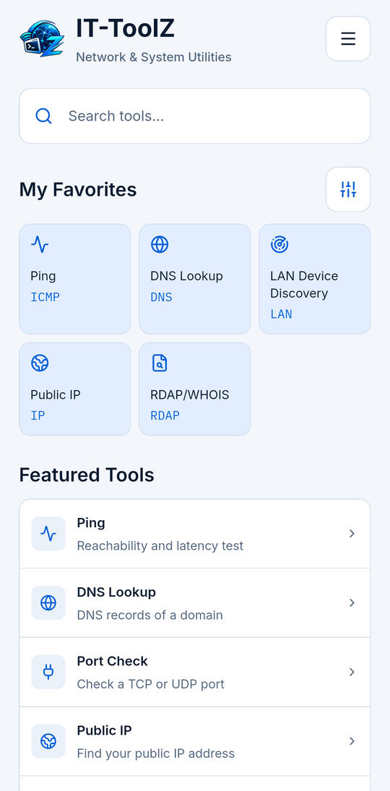
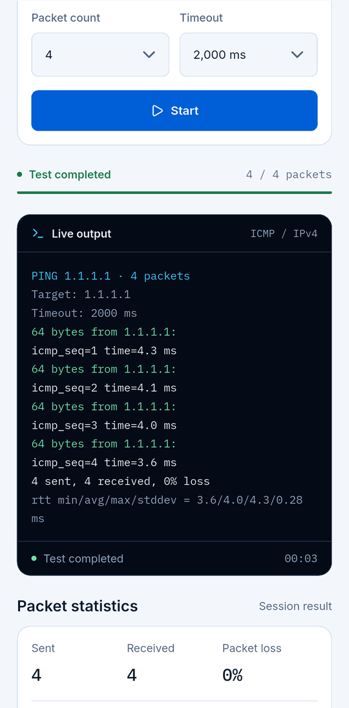
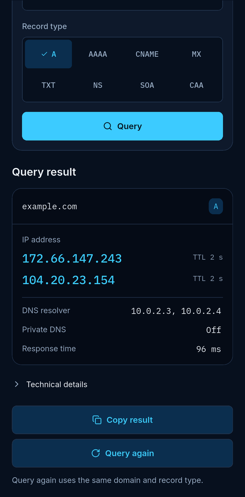

  

  <b>Network &amp; System Utilities</b> 
  Des outils réseau et système pour les pros de l'IT, dans votre poche. 
  Sans compte. Sans publicité. Sans pistage.

  
  

  <a href="README.md">English</a> · <a href="README.tr.md">Türkçe</a> · <a href="README.de.md">Deutsch</a> · <a href="README.es.md">Español</a> · <a href="README.pt-BR.md">Português (Brasil)</a> · <b>Français</b> · <a href="README.ru.md">Русский</a>

---

## Qu'est-ce qu'IT-ToolZ ?

Une boîte à outils ciblée pour les professionnels de l'IT et des réseaux qui ont besoin de réponses rapides loin de leur bureau. Dix-neuf outils et une vue d'ensemble du réseau sur votre appareil, sans compte, publicité ni pistage.

## Outils

### Outils réseau

- **Ping** – Accessibilité, latence
- **Traceroute** – Chemin, saut par saut
- **DNS Lookup** – Tous les enregistrements
- **Reverse DNS** – Nom depuis une IP
- **Port Check** – Ports TCP et UDP
- **Subnet Calculator** – Plages, masques, hôtes
- **IP Converter** – Convertir les formats IP
- **Public IP** – Votre IPv4 et IPv6
- **NTP Time Checker** – Écart d'horloge NTP
- **Wake-on-LAN** – Réveiller des PC à distance *(Android)*
- **LAN Device Discovery** – Appareils de votre LAN

### Sécurité et certificats

- **SSL Certificate Checker** – Chaîne, validité, confiance
- **RDAP/WHOIS** – Registre domaines et IP
- **Password Generator** – Mots de passe robustes

### Outils développeur

- **HTTP Headers** – En-têtes, redirections
- **Hash Generator** – MD5, SHA-1, SHA-256
- **Base64** – Encoder et décoder
- **URL Encoder/Decoder** – Encodage pourcent
- **JSON Formatter** – Formater, valider

## Captures d'écran

  
  
  

Captures avec l'interface en anglais.

## Téléchargement

Android 10 ou plus récent · iOS 16 ou plus récent, iPhone et iPad

  
  

## Confidentialité

Pas de compte, pas d'analyse, pas de publicité, pas de serveur à nous. L'historique et les favoris restent sur votre appareil. Les requêtes réseau ne vont qu'aux cibles que vous choisissez et aux services nécessaires à une recherche (votre résolveur DNS, les registres RDAP et ipwho.is pour les détails IP, avec ipify/ifconfig.me en secours). Les détails figurent dans la politique de confidentialité.

---

La page complète est en anglais : [README.md](README.md) · [Politique de confidentialité](PRIVACY.md) · [Modifications](CHANGELOG.md)
