

  

  <b>Network & System Utilities for IT professionals — in your pocket.</b> 
  Ping, Traceroute, DNS, Port Check, SSL, WHOIS, LAN discovery, Wake-on-LAN and more. 
  No account. No ads. No tracking.

  
  

  
  
  
  
  

  <b>English</b> · <a href="README.tr.md">Türkçe</a> · <a href="PRIVACY.md">Privacy Policy</a>

---

## What is IT-ToolZ?

**IT-ToolZ** is a mobile toolkit for network engineers, system administrators, help-desk staff and developers. It puts **19 everyday IT tools** into one fast, clean app for **Android** and **iOS**: real ICMP ping, hop-by-hop traceroute, DNS records, TCP and UDP port checks, TLS certificate details, RDAP/WHOIS, public IP with ASN and location, local network discovery, Wake-on-LAN, subnet math and developer helpers.

Every tool runs only when you tap it, shows exactly what was measured and how, and keeps your data on your device.

## Highlights

- 🛠️ **19 tools in one app.** Network diagnostics, security checks and developer utilities.
- 📡 **Real measurements.** Ping uses real ICMP echo; a TCP connection is never labelled as a ping. Every result shows its method, source and timing under "Technical details".
- 🌐 **IPv4 and IPv6.** Choose IPv4, IPv6 or Auto wherever it matters.
- 🔒 **Private by design.** No account, no analytics, no crash reporting, no ads and no server of our own. History and favorites stay on your device and are excluded from cloud backup.
- ⭐ **Favorites and history.** Pin your most used tools to the home screen, reorder them, and re-run any past check with its original settings.
- 🌓 **Light, dark or system theme.** Easy on the eyes in the server room at night.
- 🌍 **7 languages.** Switch instantly, no restart needed.
- 📋 **Copy anything.** Every result can be copied as clean text for tickets and reports.

## Tools

### Network tools

| Tool | What it does |
|---|---|
| **Ping** | Reachability and latency with real ICMP echo: live output, packet loss and min / avg / max round-trip times with standard deviation. |
| **Traceroute** | The network path to a host, hop by hop, with the response time of every probe. |
| **DNS Lookup** | A, AAAA, CNAME, MX, TXT, NS, SOA and CAA records with TTLs and the resolver that answered. Ask your device's DNS or a server you choose: 1.1.1.1, 8.8.8.8 or your own. |
| **Reverse DNS** | The host name (PTR) of an IPv4 or IPv6 address. |
| **Port Check** | Whether a TCP port is open, closed or filtered, plus a UDP mode. |
| **Subnet Calculator** | Network, broadcast, masks, first and last usable host and host counts for any CIDR block. |
| **IP Converter** | IP addresses in dotted, decimal, hexadecimal and binary forms. |
| **Public IP** | Your public IPv4 and IPv6 address with network (ASN, ISP), country, city and time zone; open the coordinates in your maps app. |
| **NTP Time Checker** | Compares the device clock with an NTP server and shows the offset and delay. |
| **Wake-on-LAN** | Wakes computers on your network with a magic packet. |
| **LAN Device Discovery** | Finds devices on your local network, shows host names and response times, and checks 30 common ports per device. *(Android)* |

### Security & certificates

| Tool | What it does |
|---|---|
| **SSL Certificate Checker** | Certificate chain, validity, days left, issuer, SANs, fingerprints and TLS version of any host. |
| **RDAP/WHOIS** | Domain registration data through RDAP; for IP addresses, network and approximate location. |
| **Password Generator** | Strong random passwords generated on the device; never stored, and screenshots are blocked. |

### Developer tools

| Tool | What it does |
|---|---|
| **HTTP Headers** | Response headers, status codes and the full redirect chain of a URL. |
| **Hash Generator** | MD5, SHA-1, SHA-256 and SHA-512 of any text. |
| **Base64** | Encode and decode Base64, Unicode-safe. |
| **URL Encoder/Decoder** | Percent-encode and decode URLs and query values. |
| **JSON Formatter** | Validate, pretty-print and minify JSON with clear error messages. |

### Pages

- **Home:** search, your favorite tools and featured tools.
- **All Tools:** every tool grouped by category.
- **My Network:** your connection at a glance (Wi-Fi or mobile data, local addresses, gateway, DNS servers) and your public IP on demand.
- **History:** every check with its result; tap to re-run, long-press to delete.
- **Settings:** theme, language, data and support.

## Screenshots

**Light theme**

  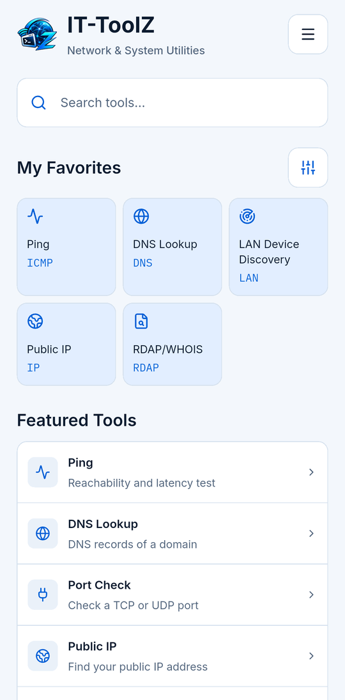
  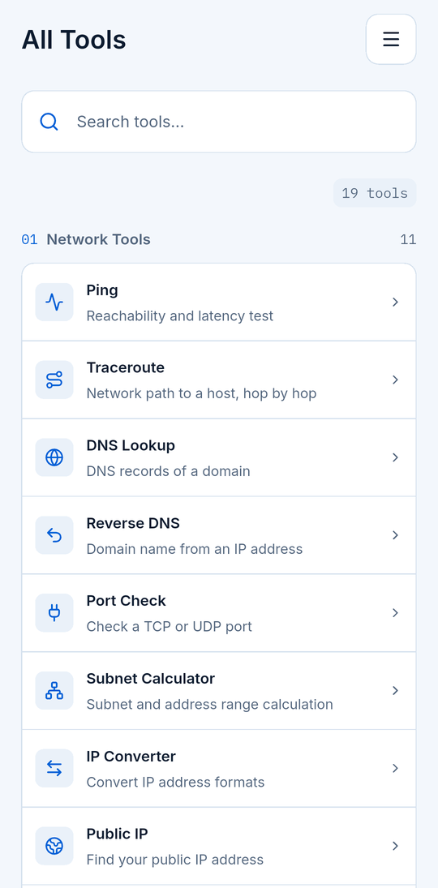
  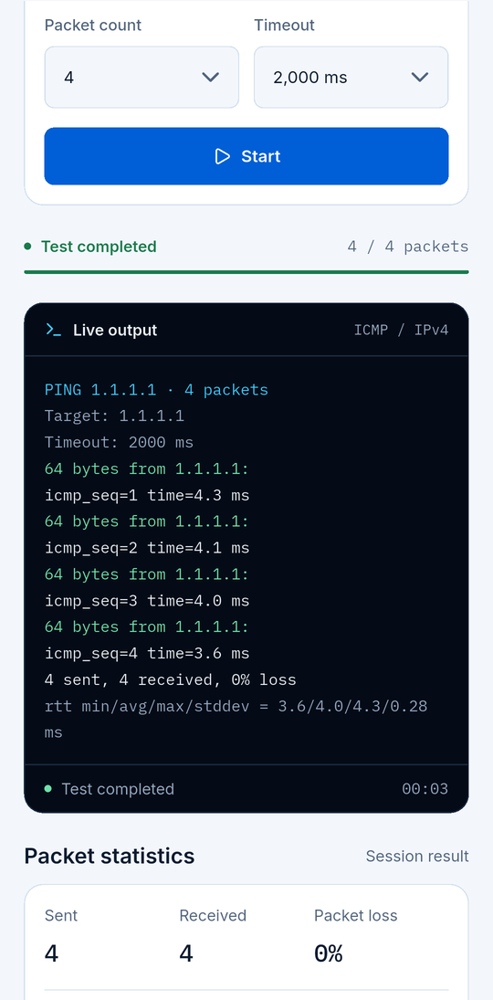

  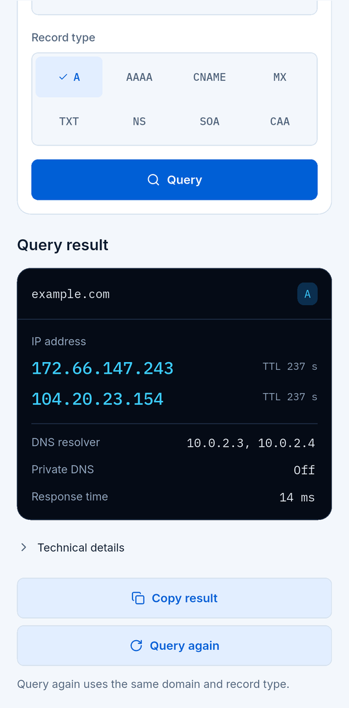
  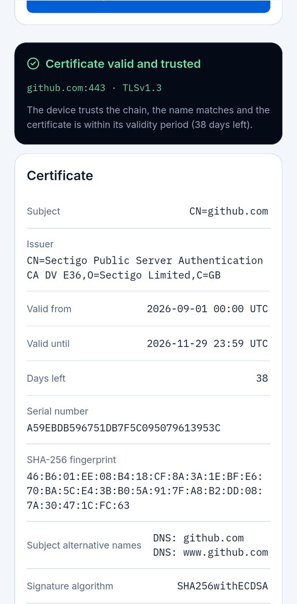
  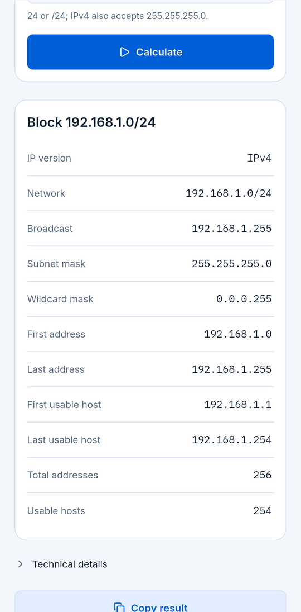

**Dark theme**

  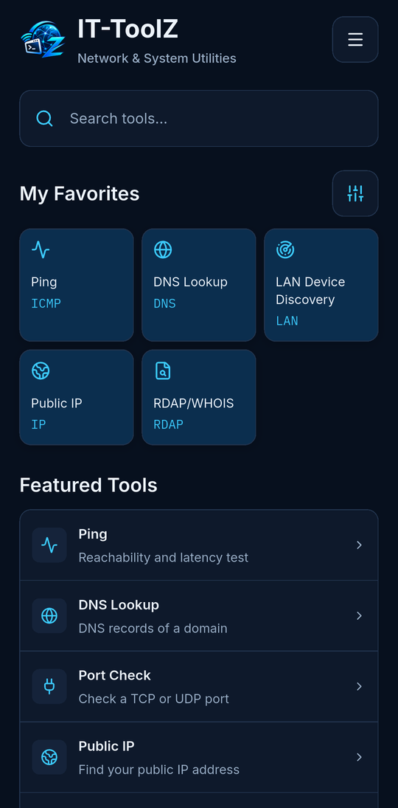
  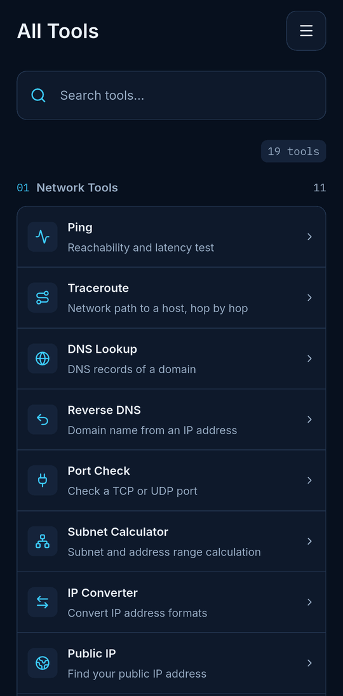
  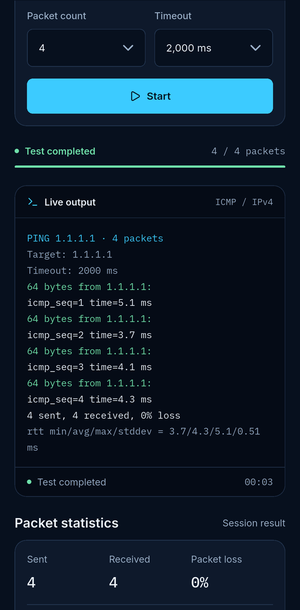

  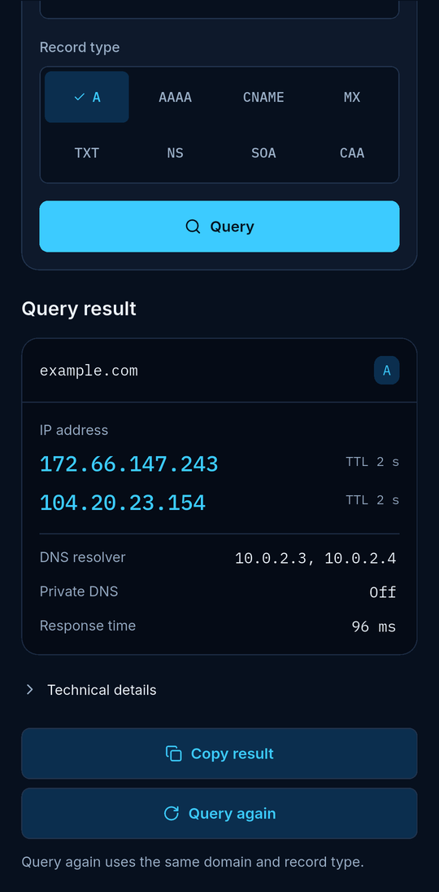
  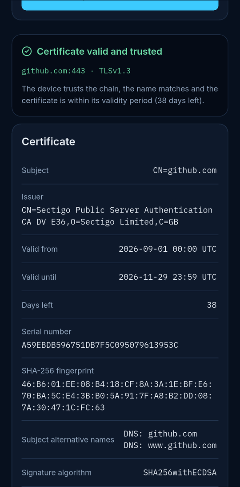
  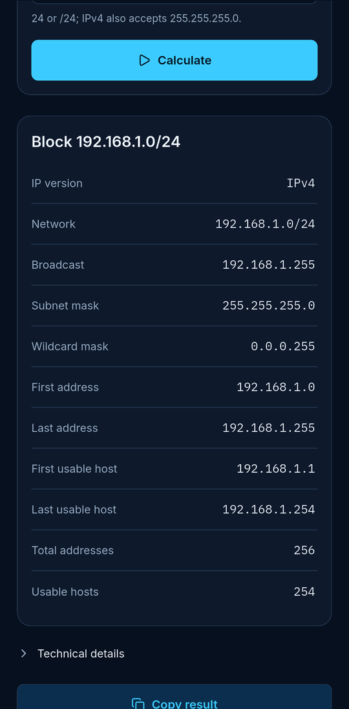

## Languages

IT-ToolZ speaks **7 languages**, and the app language can be changed at any time in Settings:

🇬🇧 English · 🇹🇷 Türkçe · 🇩🇪 Deutsch · 🇪🇸 Español · 🇧🇷 Português (Brasil) · 🇫🇷 Français · 🇷🇺 Русский

## Download

| Platform | Requirement | Get it |
|---|---|---|
|  | Android 10 or later |  |
|  | iOS 16 or later |  |

## Privacy

IT-ToolZ has **no user accounts, no analytics, no ads and no server of its own**. The app connects to the internet only when you start a tool, and only to the destination you choose or to the few public services a tool needs (for example ipwho.is for public IP details). History, favorites and settings never leave your device.

Read the full [Privacy Policy](PRIVACY.md).

## Release notes

### 1.0.1 — in closed testing on Google Play

- **DNS Lookup:** choose the DNS server — your device's DNS, 1.1.1.1, 8.8.8.8 or your own server IP.
- **Public IP and RDAP/WHOIS:** tap the coordinates to open them in your maps app.
- Cleaner IP details tables: labels left, values right.

### 1.0.0 — first release

- 19 tools: Ping, Traceroute, DNS Lookup, Reverse DNS, Port Check (TCP and UDP), Subnet Calculator, IP Converter, Public IP, NTP Time Checker, Wake-on-LAN, LAN Device Discovery, SSL Certificate Checker, RDAP/WHOIS, Password Generator, HTTP Headers, Hash Generator, Base64, URL Encoder/Decoder and JSON Formatter.
- My Network page, favorites, history with re-run.
- Light, dark and system themes; 7 languages.

All changes: [CHANGELOG.md](CHANGELOG.md)

## Contact

Questions, ideas or bug reports? Please [open an issue on GitHub](https://github.com/buadamlaz/it-toolz/issues). The support address is also shown in the app under Settings → Contact & Support.

---

   
  IT-ToolZ 1.0.0 · Network & System Utilities

