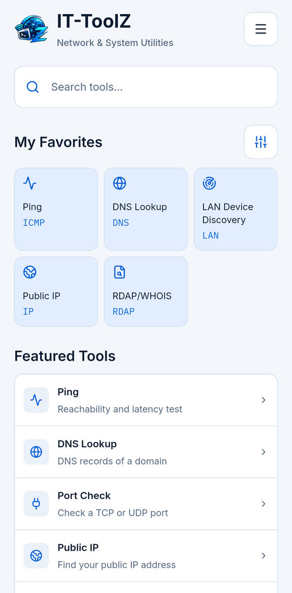
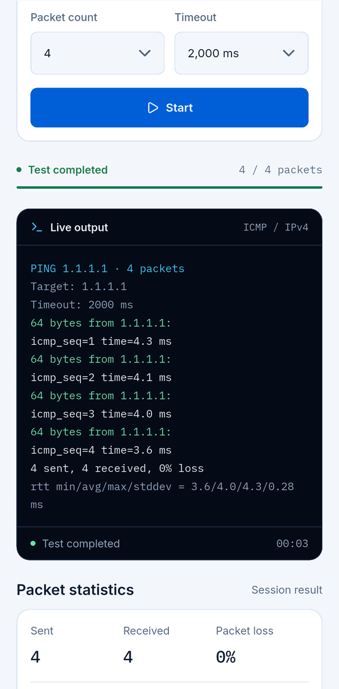
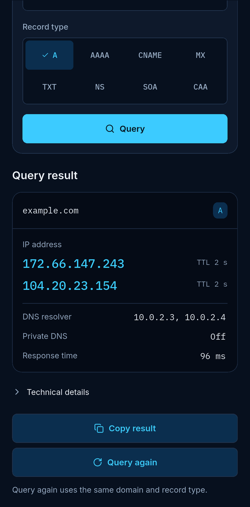

  

  <b>Network &amp; System Utilities</b> 
  Ferramentas de rede e sistema para profissionais de TI, no seu bolso. 
  Sem conta. Sem anúncios. Sem rastreamento.

  
  

  <a href="README.md">English</a> · <a href="README.tr.md">Türkçe</a> · <a href="README.de.md">Deutsch</a> · <a href="README.es.md">Español</a> · <b>Português (Brasil)</b> · <a href="README.fr.md">Français</a> · <a href="README.ru.md">Русский</a>

---

## O que é o IT-ToolZ?

Um kit de ferramentas focado para profissionais de TI e redes que precisam de respostas rápidas longe da mesa. Dezenove ferramentas e um resumo da rede no seu dispositivo, sem contas, anúncios ou rastreamento.

## Ferramentas

### Ferramentas de rede

- **Ping** – Alcance e latência
- **Traceroute** – Caminho, salto a salto
- **DNS Lookup** – Todos os registros
- **Reverse DNS** – Nome a partir de um IP
- **Port Check** – Portas TCP e UDP
- **Subnet Calculator** – Faixas, máscaras, hosts
- **IP Converter** – Converte formatos de IP
- **Public IP** – Seu IPv4 e IPv6
- **NTP Time Checker** – Diferença do relógio p/ NTP
- **Wake-on-LAN** – Ligue PCs remotamente *(Android)*
- **LAN Device Discovery** – Dispositivos na sua LAN

### Segurança e certificados

- **SSL Certificate Checker** – Cadeia, validade, confiança
- **RDAP/WHOIS** – Registro de domínios e IP
- **Password Generator** – Senhas aleatórias fortes

### Ferramentas de desenvolvimento

- **HTTP Headers** – Cabeçalhos, redirecionamentos
- **Hash Generator** – MD5, SHA-1, SHA-256
- **Base64** – Codifica e decodifica
- **URL Encoder/Decoder** – Codificação percentual
- **JSON Formatter** – Formata e valida

## Capturas de tela

  
  
  

Capturas com a interface em inglês.

## Download

Android 10 ou mais recente · iOS 16 ou mais recente, iPhone e iPad

  
  

## Privacidade

Sem conta, sem análises, sem anúncios e sem servidor próprio. Histórico e favoritos ficam no seu dispositivo. As requisições de rede vão apenas para os destinos que você escolhe e para os serviços que uma consulta precisa (seu resolvedor DNS, registros RDAP e ipwho.is para detalhes de IP, com ipify/ifconfig.me como alternativa). Os detalhes estão na política de privacidade.

---

A página completa está em inglês: [README.md](README.md) · [Política de privacidade](PRIVACY.md) · [Alterações](CHANGELOG.md)
