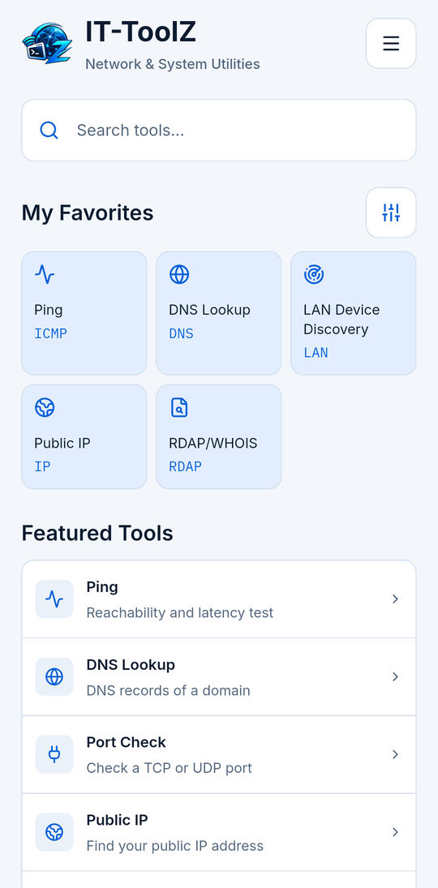
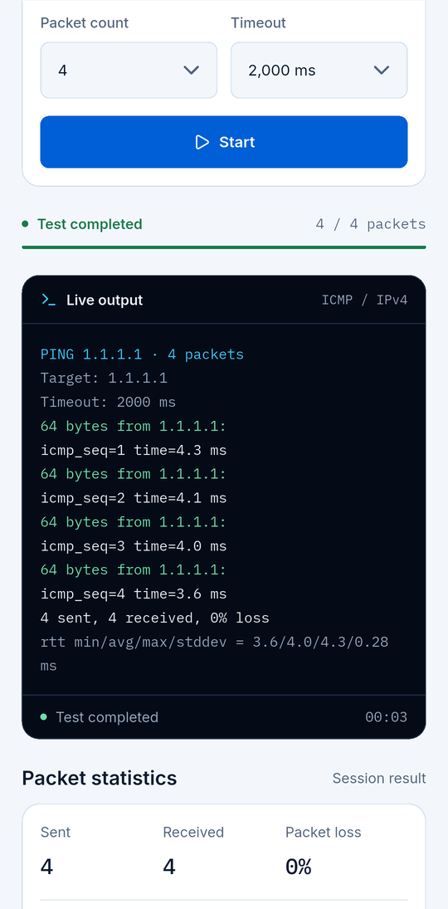
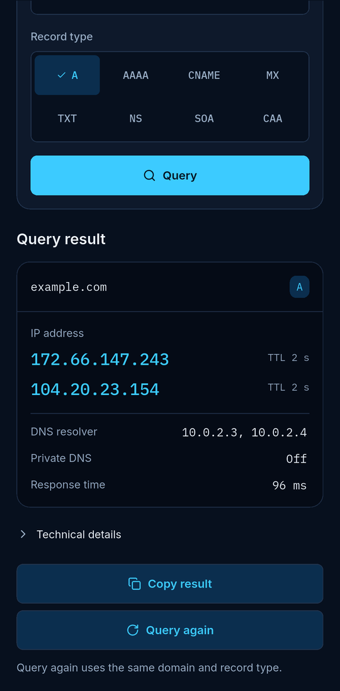

  

  <b>Network &amp; System Utilities</b> 
  Herramientas de red y sistema para profesionales de IT, en tu bolsillo. 
  Sin cuenta. Sin anuncios. Sin rastreo.

  
  

  <a href="../README.md">English</a> · <a href="README.tr.md">Türkçe</a> · <a href="README.de.md">Deutsch</a> · <b>Español</b> · <a href="README.pt-BR.md">Português (Brasil)</a> · <a href="README.fr.md">Français</a> · <a href="README.ru.md">Русский</a>

---

## ¿Qué es IT-ToolZ?

Un conjunto de herramientas pensado para profesionales de IT y redes que necesitan respuestas rápidas lejos de su escritorio. Diecinueve herramientas y un resumen de la red en tu dispositivo, sin cuentas, anuncios ni rastreo.

## Herramientas

### Herramientas de red

- **Ping** – Alcance y latencia
- **Traceroute** – Ruta, salto a salto
- **DNS Lookup** – Todos los registros
- **Reverse DNS** – Nombre a partir de una IP
- **Port Check** – Puertos TCP y UDP
- **Subnet Calculator** – Rangos, máscaras, hosts
- **IP Converter** – Convierte formatos IP
- **Public IP** – Tu IPv4 e IPv6
- **NTP Time Checker** – Desfase del reloj con NTP
- **Wake-on-LAN** – Enciende PCs a distancia *(Android)*
- **LAN Device Discovery** – Dispositivos de tu LAN

### Seguridad y certificados

- **SSL Certificate Checker** – Cadena, validez, confianza
- **RDAP/WHOIS** – Registro de dominios e IP
- **Password Generator** – Contraseñas aleatorias seguras

### Herramientas de desarrollo

- **HTTP Headers** – Cabeceras, redirecciones
- **Hash Generator** – MD5, SHA-1, SHA-256
- **Base64** – Codifica y decodifica
- **URL Encoder/Decoder** – Codificación por porcentaje
- **JSON Formatter** – Formatea y valida

## Capturas

  
  
  

Capturas con la interfaz en inglés.

## Descarga

Android 10 o posterior · iOS 16 o posterior, iPhone y iPad

  
  

## Privacidad

Sin cuenta, sin analíticas, sin anuncios y sin servidor propio. El historial y los favoritos se quedan en tu dispositivo. Las peticiones de red solo van a los destinos que eliges y a los servicios que necesita una consulta (tu resolvedor DNS, los registros RDAP e ipwho.is para los datos de IP, con ipify/ifconfig.me como alternativa). Los detalles están en la política de privacidad.

---

La página completa está en inglés: [README.md](../README.md) · [Política de privacidad](PRIVACY.es.md) · [Cambios](CHANGELOG.md)
