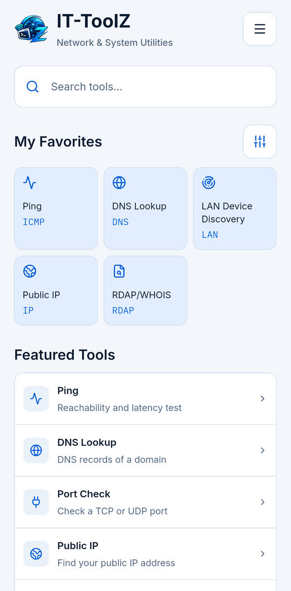
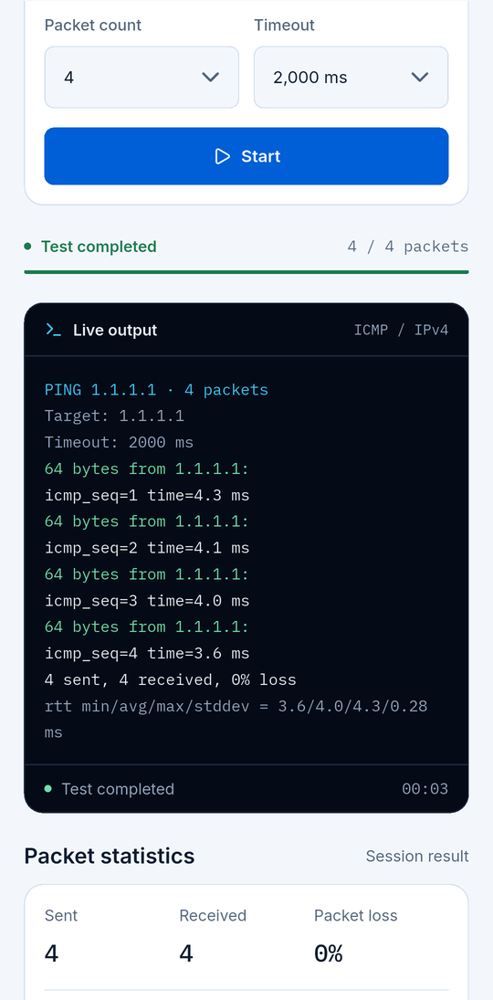
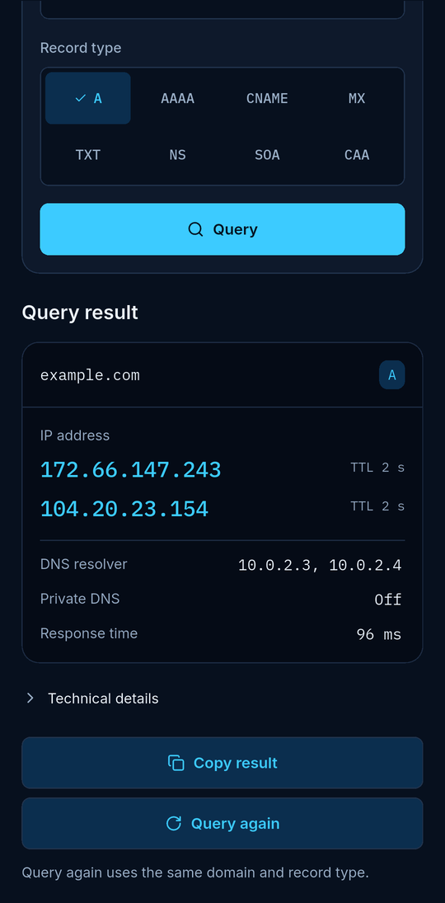

  

  <b>Network &amp; System Utilities</b> 
  Сетевые и системные инструменты для IT-специалистов, всегда под рукой. 
  Без аккаунта. Без рекламы. Без слежки.

  
  

  <a href="../README.md">English</a> · <a href="README.tr.md">Türkçe</a> · <a href="README.de.md">Deutsch</a> · <a href="README.es.md">Español</a> · <a href="README.pt-BR.md">Português (Brasil)</a> · <a href="README.fr.md">Français</a> · <b>Русский</b>

---

## Что такое IT-ToolZ?

Компактный набор инструментов для IT-специалистов и сетевых инженеров, которым нужны быстрые ответы вдали от рабочего места. Девятнадцать инструментов и обзор сети прямо на устройстве, без аккаунта, рекламы и слежки.

## Инструменты

### Сетевые инструменты

- **Ping** – Доступность, задержка
- **Traceroute** – Маршрут по хопам
- **DNS Lookup** – Все типы записей
- **Reverse DNS** – Имя по IP-адресу
- **Port Check** – Порты TCP и UDP
- **Subnet Calculator** – Диапазоны, маски, хосты
- **IP Converter** – Форматы IP-адресов
- **Public IP** – Ваши IPv4 и IPv6
- **NTP Time Checker** – Расхождение часов с NTP
- **Wake-on-LAN** – Удалённое включение ПК *(Android)*
- **LAN Device Discovery** – Устройства в вашей LAN

### Безопасность и сертификаты

- **SSL Certificate Checker** – Цепочка, срок, доверие
- **RDAP/WHOIS** – Реестр доменов и IP
- **Password Generator** – Надёжные случайные пароли

### Для разработчиков

- **HTTP Headers** – Заголовки, редиректы
- **Hash Generator** – MD5, SHA-1, SHA-256
- **Base64** – Кодирование и декодирование
- **URL Encoder/Decoder** – Процентное кодирование
- **JSON Formatter** – Формат и проверка

## Скриншоты

  
  
  

Скриншоты с английским интерфейсом.

## Скачать

Android 10 или новее · iOS 16 или новее, iPhone и iPad

  
  

## Конфиденциальность

Без аккаунта, аналитики, рекламы и собственного сервера. История и избранное остаются на устройстве. Сетевые запросы уходят только к выбранным вами целям и к сервисам, нужным для запроса (ваш DNS-резолвер, реестры RDAP и ipwho.is для данных об IP, ipify/ifconfig.me как запасной вариант). Подробности в политике конфиденциальности.

---

Полная страница на английском: [README.md](../README.md) · [Политика конфиденциальности](PRIVACY.ru.md) · [Изменения](CHANGELOG.md)
